<p align="center"></p>

| | |
|-|-|
| **Time** | 60-75 min |
| **Cost** | free |
| **You need** | Your Ubuntu environment (WSL or OrbStack machine) with sudo |

## How this lab works

1. **Fork** this repository to your own GitHub account (button at the top right).
2. Clone **your fork** in your Ubuntu environment (WSL on Windows, your OrbStack machine on Mac).
3. Read the lab below (the same text is in [`LAB.md`](LAB.md)) and follow the mission.
4. Answer the questions in [`SUBMISSION.md`](SUBMISSION.md). Where a question asks for output, paste it in a code block. No screenshots needed.
5. Commit and push. Open the **Actions** tab of your fork (click *I understand my workflows, go ahead and enable them* the first time). The **Lab check** shows what is still missing.
6. When the check is green, **submit the URL of your fork** in the course platform.

> [!NOTE]
> The check only looks at your answers and any files the lab asks you to commit. Your instructor reads your work and may ask you to explain any line.

<p align="center"></p>

## The situation

Friday, 16:45. Maya, Clipstr's lead developer, leaves the company today. Her laptop goes back at 17:30. The CTO has one instruction: *"By the time she walks out, she must have no way into our servers. And do not break anything while you do it."*

You open the staging server and find out nobody has looked at its accounts in two years. Maya has `sudo`. She belongs to several groups. Files and jobs and processes are hers. And somewhere in there, there might be accounts that nobody remembers.

> [!IMPORTANT]
> **Your mission**
> - **Audit** the server and find every account and permission that is a risk
> - **Offboard Maya**: remove every way she can get in, keep her work, and hand it to Priya
> - **Onboard Tomas**, the new hire, with only the sudo right he needs
> - Prove nobody else was harmed

**Time:** 60-75 min | **Cost:** free | **You need:** your Ubuntu environment with `sudo`. This lab creates users on it, so do not run it on a shared machine. `sudo ./teardown.sh` removes everything.

<p align="center"></p>

## Part 0 - Set the scene

Fork this repository, clone your fork inside your Ubuntu environment, then run:

```bash
sudo ./setup.sh
```

Then look at what `verify.sh` thinks of the server right now (it will be unhappy, that is the point):

```bash
sudo ./verify.sh
```

Do not fix anything from the list yet. First you investigate.

<p align="center"></p>

## Part 1 - Audit: who is on this server?

You get questions, not commands. Finding the command is your job. Use `man`, `--help`, or ask your AI chat *how* to find something. Keep a note of the command that answered each question, you will paste some in your submission.

| # | Question | Where to look |
|---|----------|---------------|
| 1 | How many human accounts exist (UID 1000 or above)? Who are they? | `/etc/passwd`, `getent` |
| 2 | Who can use `sudo`? There are **two different ways** someone can get it. Find both. | groups, `/etc/sudoers.d/` |
| 3 | Which accounts are in the group `devs`? In `ops`? | `getent group`, `id` |
| 4 | Is there any account **other than root** that has UID 0? What does that mean? | `/etc/passwd`, third field |
| 5 | Is there any account with an **empty password**? | `/etc/shadow` (root only), second field |
| 6 | What does `passwd -S` print for each human? What do the letters mean? | `man passwd` |
| 7 | When did Maya last change her password? Does it ever expire? | `chage -l` |

> [!NOTE]
> **Predict** Before you run anything for question 4: how many accounts do you expect to have UID 0? Then check. If the answer is more than one, you just found the most dangerous thing on this server.

> [!NOTE]
> **Think** For question 2: why is `%devs ALL=(ALL) NOPASSWD: ALL` a problem for *every* member of the group, not just Maya? What does `NOPASSWD` change if someone steals a developer's SSH key?

<p align="center"></p>

## Part 2 - Investigate: where is Maya's footprint?

Deleting her account is not offboarding. Access hides in five places. Find each one:

1. **Groups:** which privileged groups is she in?
2. **SSH:** how could she log in without a password from her laptop? Look in her home directory.
3. **Cron:** does she have scheduled jobs running on this server?
4. **Processes:** is anything running **as Maya** right now? (`ps`, `pgrep`)
5. **Files:** which files outside her home directory does she own? (`find / -xdev -user maya`)

Write down, for each, the command that found it. One of her files is `/srv/clipstr/backups`, a directory the whole team writes into. What happens to that directory if you just delete Maya?

> [!NOTE]
> **Think** `restore-db.md` in her home directory explains how to restore the database, and she is the only person who knows. What is the cost of deleting her home directory today?

<p align="center"></p>

## Part 3 - Experiment: why not just delete the account?

Do this on a throwaway user so you can see it for yourself:

```bash
sudo useradd -m ghost
id ghost
echo "ghost's private notes" | sudo -u ghost tee /home/ghost/diary.txt
sudo chmod 600 /home/ghost/diary.txt
sudo userdel ghost
```

> [!NOTE]
> **Predict** The account is gone but the home directory (without `-r`) is still there. Who owns `/home/ghost/diary.txt` now? What will `ls -l` show?

Check with `sudo ls -ln /home/ghost` and `sudo find / -xdev -nouser`. Then create a **brand new** user, `stranger`, and compare its UID with ghost's old one:

```bash
sudo useradd -m stranger
id stranger
sudo cat /home/ghost/diary.txt
```

> [!WARNING]
> **Break it** `stranger` is a completely different person, yet something strange just happened. Explain what, in your own words. This is why the rule on a real server is: **lock and expire, do not delete, until you have handed the files over**.

Remove the experiment: `sudo userdel -r stranger; sudo rm -rf /home/ghost`.

<p align="center"></p>

## Part 4 - Offboard Maya (a script, because there will be a next time)

Write `offboard.sh` that does **everything**, for any user given as `$1`, in a safe order. At the end it must:

- **Lock** the password, **expire** the account and set the shell to `/usr/sbin/nologin`
- **Kill** every process she owns
- **Remove** her cron jobs
- **Empty** her SSH `authorized_keys`
- **Remove** her from `sudo`, `devs` and `ops`
- **Archive** her home directory to `/var/backups/maya-home.tar.gz`, so her knowledge survives
- **Reassign** her files under `/srv/clipstr` to **Priya**
- NOT delete the account

Make it a proper script: `set -euo pipefail`, a `usage` message when `$1` is missing, and a variable for the successor.

> [!TIP]
> **Stuck?** Starting points: `usermod -L -e 1 -s ...`, `pkill -KILL -u`, `crontab -u USER -r`, `gpasswd -d USER GROUP`, `tar czf`, `find DIR -user USER -exec chown NEW {} +`. Look each one up before you use it.

Then deal with the accounts nobody remembered. Decide what to do with the extra UID 0 account and with `sam-contractor` (the empty password). Put those fixes in the same script, or in a second one, and **write one sentence in your submission about why** you chose to delete or to lock each.

> [!TIP]
> **Checkpoint** Test it: `sudo su - maya` should now refuse to give you a shell, and `sudo ./verify.sh` should show the "Maya has left" and "accounts nobody remembered" sections green.

<p align="center"></p>

## Part 5 - Onboard Tomas, with the least sudo possible

Tomas starts Monday. He needs to restart the app when it hangs, and nothing else.

Write `onboard.sh` that:

- Creates `tomas` with a home directory and `bash`, in the group `devs`
- Sets a temporary password and **forces a change at first login**
- Gives him sudo for **exactly one command**: `systemctl restart clipstr`, without a password prompt, and nothing else
- Removes the old `%devs ... NOPASSWD: ALL` rule

Rules for sudo files:

1. Put your rule in its own file in `/etc/sudoers.d/` (mode `0440`), never edit `/etc/sudoers` directly.
2. Always validate **before** installing: `visudo -cf yourfile`.

> [!WARNING]
> **Break it** Write a draft with a typo (for example `NOPASWD:`) and run `visudo -cf` on it. Read the error. Now think about what would happen if you had put that typo straight into `/etc/sudoers.d/` with a normal editor, and then lost your only root session.

Prove it: `sudo -l -U tomas` should list exactly one command.

<p align="center"></p>

## Part 6 - Prove nobody else was harmed

```bash
sudo ./verify.sh
```

Every check must pass. `verify.sh` also checks that Priya still has her groups and her account, because offboarding that locks out the team is a worse day than the leak you were preventing.

<p align="center"></p>

## Level up (optional)

- **Inactive accounts.** Find accounts that have never logged in or not logged in for 90 days (`lastlog`, `lastlog -b 90`). Which would you disable?
- **Password policy.** Set a maximum password age of 90 days for new users in `/etc/login.defs` and for Tomas with `chage`.
- **Make it idempotent.** Run `offboard.sh maya` twice. Does the second run fail? Make it safe to run again.

<!-- teardown:start (generated by labs.py, do not edit) -->
## Tear down (mandatory)

Resources left behind cost money, keep doors open and pollute the next lab. Removing what you created is part of the job, so it is part of the submission: **you must prove it is gone**.

Do this **last**, after you have pasted your `verify` output into `SUBMISSION.md` (once you tear down, the lab can no longer be verified).

1. Run `sudo ./teardown.sh`. It removes every account, group, sudo rule, cron job and file the lab created (including Maya's archive).
2. If you created `ghost` and `stranger` for the experiment and still have them, `teardown.sh` removes those too.

Then run the proof:

```bash
sudo ./verify-teardown.sh
```

It prints a list of checks and must end with **TEARDOWN VERIFIED**. If it reports leftovers, remove them and run it again. Paste the full output in your submission.
<!-- teardown:end -->

<!-- submission:start (generated by labs.py, do not edit) -->
## Submission

Answer the questions in `SUBMISSION.md` in **your fork** (paste output in code blocks where asked), push, then submit the **URL of your fork**.

**Files to commit**

- `offboard.sh` and `onboard.sh`: your two scripts, committed to the repo

**Questions to answer**

1. Paste the commands you used to answer the audit questions in Part 1 and what they showed. Which two accounts were the biggest risks, and why?
2. Why lock Maya's account instead of deleting it? Describe what you saw in the `ghost` experiment (the UID reuse) and why it is a security problem.
3. Maya had access in five different places (groups, SSH, cron, a running process, files). List all five and the command you used to find or fix each.
4. Paste the `sudo -l -U tomas` output. Why is `NOPASSWD: ALL` for a whole group dangerous, and why do you edit sudoers with `visudo` or `visudo -cf` and never with a plain editor?
5. Paste the output of `sudo ./verify.sh` after running your scripts. It must end with **ALL CHECKS PASSED**.
6. **Tear down.** Paste the output of `sudo ./verify-teardown.sh`. It must end with **TEARDOWN VERIFIED**.
<!-- submission:end -->
